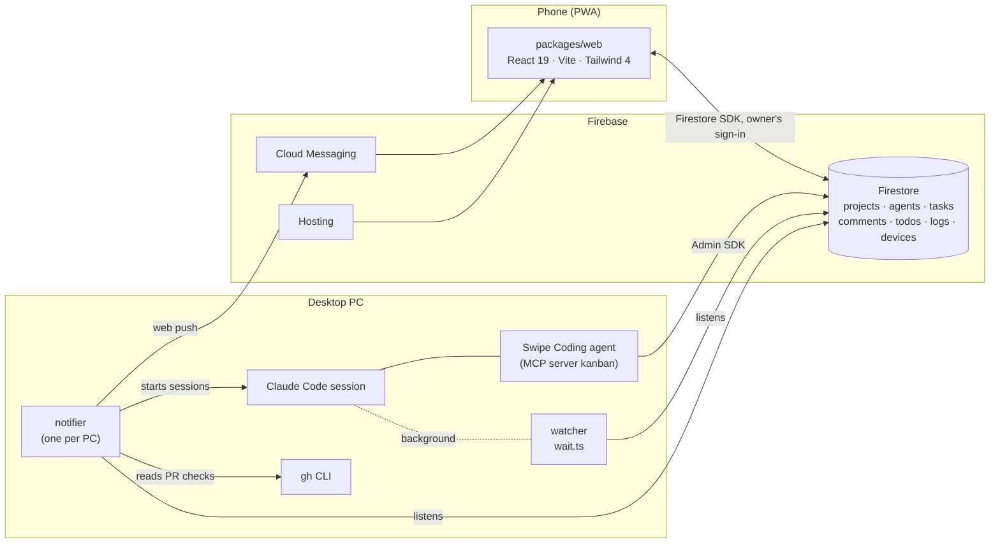
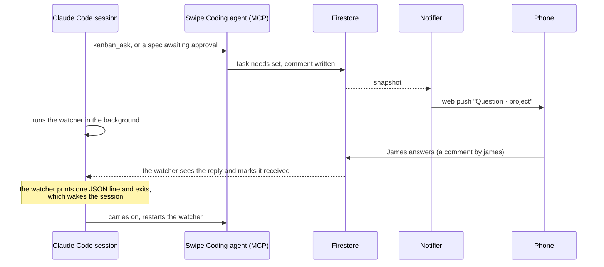

# Swipe Coding

**Steer the Claude Code sessions running on your PC from your phone, one swipe at a time.**

Swipe Coding is a phone-first board for your coding sessions. Each Claude Code session reports its work to the board as a task: a spec to approve, a question,
a pull request ready to merge. The phone shows one decision at a time as a full-screen card. You
swipe right to agree, swipe left for later, or talk to it. Your answer reaches the session within
seconds, and the session carries on.

It is a personal tool with one owner and no AI inside the app. The Claude Code sessions are
Swipe Coding's clients; it never calls a model itself.

> **About the name.** Swipe Coding began life as "kanban", and the code still uses that working
> name: the repository, the `@kanban/*` packages, the MCP server (`kanban`) and the `kanban_*`
> tools the sessions call. Those identifiers stay as they are; the product is Swipe Coding.

---

## What it does

- **One card at a time.** The home screen is a deck of decisions, most important first. Each
  card says in one line what happens if you agree ("Build it", "Merge", "Got it"), with a short
  brief underneath: where the work came from, why it exists, what changes, and what you are
  agreeing to.
- **Swipe to decide.** Right is yes, left is later. Swipe up for the details, down for an
  overview of everything waiting, grouped by project.
- **Talk instead of typing.** The microphone turns your voice into a note for the session, so
  you can change a spec, answer a question or ask for something else. A speaker button reads a
  card aloud.
- **Notifications.** When a session needs you, the phone gets a push ("Spec · my-app", with the
  project name and the card's headline). Tapping it opens that card.
- **Merge cards only when they are ready.** A pull request reaches you only after GitHub says
  every check has passed. If a check fails, the session hears about it and fixes it first.
- **Start a session from the phone.** Pick a project, name the work, describe the idea, and the
  PC starts a new Claude Code session in that folder. Its first card (usually a spec) comes
  back to the deck.
- **Threads and history.** Every task keeps its conversation, its decision log and its stage, at
  `/threads`. Finished work leaves the lists after seven days and can be reopened with a note.
- **To-dos for you.** Things only you can do (rotate a key, test on the phone) sit in a to-do
  drawer, grouped by project, not on the deck.

---

## How it works

### The pieces



There is no server of our own and no Cloud Functions. Firestore is the only shared state; every
process listens to it with `onSnapshot` and writes small documents.

| Piece        | Where                            | What it does                                                                                                                                                                                                  |
| ------------ | -------------------------------- | ------------------------------------------------------------------------------------------------------------------------------------------------------------------------------------------------------------- |
| **Web app**  | `packages/web`                   | The phone-first PWA: the deck (`/`), threads (`/threads`, `/t/:id`), projects (`/projects`). Reads and writes Firestore directly as the signed-in owner.                                                      |
| **Agent**    | `packages/agent/src/index.ts`    | An MCP server that Claude Code starts once per session. Gives the session its `kanban_*` tools, registers the session as an agent with a heartbeat, and writes tasks, stages and comments with the Admin SDK. |
| **Watcher**  | `packages/agent/src/wait.ts`     | A background command each session runs after taking a task. It waits for your next reply, marks it received, prints it as one JSON line and exits, which wakes the session. The session then starts it again. |
| **Notifier** | `packages/agent/src/notifier.ts` | One long-running process per PC, started at logon. It sends the push notifications, starts sessions you ask for from the phone, and watches pull requests' checks.                                            |
| **Shared**   | `packages/shared`                | Types, the stage chains, the brief format and project-id derivation, used by both sides. Plain TypeScript, no build step.                                                                                     |

### Tasks and stages

In Swipe Coding, every piece of work is a task in a project. A project is a folder on a given PC; a git worktree
counts as its main checkout's project. Each task type has a fixed chain of stages:

| Type    | Stages                                                                  |
| ------- | ----------------------------------------------------------------------- |
| Feature | spec → approved → build → pr → merged → main_ci → _after_deploy_ → done |
| Bug fix | fix → pr → merged → main_ci → _after_deploy_ → done                     |
| Chore   | do → _after_deploy_ → done                                              |

`after_deploy` appears only when there is something for you to check by hand once it is live.
Sessions move a task along its chain with `kanban_subtask`. When a step needs you, the task
carries a single `needs` (approve this spec, answer this question, merge this PR), and that is
what becomes a card on the deck. Every decision you make is added to the task's log.

### A reply's round trip



Replies reach every session the same way, however it was started: terminal, desktop app,
background or SDK. Each line the watcher prints is treated as if you had typed it in that
session. Destructive actions still go through Claude Code's own permission prompt
([ADR 0005](docs/decisions/0005-replies-by-watcher.md)).

### Gates and briefs

The sessions that build this repo follow a spec-first workflow, and the board is where its gates
are answered. A spec arrives as a card with a fixed six-part brief, and approving it starts the
build. Later gates arrive as cards with one-tap answers: "fix confirmed", "another round" (when
the tests need a change after they were frozen) and "ship it". When the work is done, the task
closes with a short summary and any suggested next steps, which come back as low-priority cards.

### The notifier

A Windows logon task (`npm run notifier:install`) keeps one notifier running. It runs under
`node --watch`, so pulling main is enough to update it. A lease document in Firestore makes sure
only one notifier acts at a time. While it holds the lease it does three jobs:

1. **Push notifications.** When a task gains a need, each registered device gets one web push
   through Firebase Cloud Messaging
   ([ADR 0006](docs/decisions/0006-decision-push-via-fcm.md)).
2. **Starting sessions.** A task written from the phone with a launch request, for a project on
   this PC, is started as a background Claude Code session with Remote Control, in its own
   worktree when the folder is a git repository ([launch-session](docs/features/launch-session.md)).
3. **Watching pull requests.** When a session reports a PR, the task waits at `pr` with its
   checks `pending`. The notifier reads the PR with the PC's signed-in `gh` CLI every minute.
   When every check has passed and GitHub says it can merge, the merge card appears. If a check
   fails, the session's watcher gets a `ci_failed` line naming the checks, and a new push is
   watched again ([pr-ready](docs/features/pr-ready.md)).

You merge on GitHub yourself. The merge card links to the pull request, and agreeing on it tells
the session it was merged ([merge-on-github](docs/features/merge-on-github.md)).

### Voice

The microphone uses the phone browser's own speech recognition; the board sends no audio
anywhere itself. Tap the mic to start; it turns into a red square and stays on through Android's
pauses. Heard words show in grey italics. Tap the square to stop, tap the text to edit it, or tap
the mic again to add more ([deck-mic](docs/features/deck-mic.md)).

### Logs

The web app and the agents write structured logs to the `logs` collection, with event types from
a fixed taxonomy, kept for 30 days. Sessions read them with the `kanban_logs` tool, so a bug seen
on the phone can be investigated from the PC
([ADR 0004](docs/decisions/0004-logs-in-firestore.md), [logging](docs/logging.md)).

### Trust boundaries

- **The owner only.** Firestore rules allow one verified Google account. The browser can only
  write documents authored by you; it can never write as a session.
- **Sessions use a service account.** The agents and the notifier use the Admin SDK with a key
  kept outside the repo, in a sibling folder (`../kanban-secrets/sa.json`), and outside
  `%APPDATA%`: the Claude desktop app is an MSIX package and virtualises AppData for the
  processes it starts.
- **Outbound only.** The PC connects out to Firebase and GitHub; nothing listens on the home
  network.
- **No shell.** The notifier starts `claude` and `gh` with argument arrays, never through a
  shell, and checks names and URLs before it does.

---

## Repository layout

```
packages/shared   types, stage chains, brief format, project ids (plain TS, no build)
packages/agent    MCP server, watcher, notifier, launcher, PR watcher (Node 24, Admin SDK)
packages/web      the PWA (React 19, Vite 7, Tailwind 4, Firebase JS SDK)
tests/            vitest: unit, web components (jsdom), and emulator suites (tests/rules)
docs/             brief, architecture, feature specs, decisions (ADRs), logging, security
firebase.json · firestore.rules · firestore.indexes.json
```

## Setup

### Firebase (once)

1. Create a Firebase project. Enable **Firestore** (native mode) and **Authentication → Google**.
2. Add a **Web app** and copy its config into `packages/web/.env` (see
   `packages/web/.env.example`), including `VITE_FIREBASE_VAPID_KEY` for push notifications.
3. Create a service account with the role _Cloud Datastore User_, download a JSON key, and save
   it as `../kanban-secrets/sa.json`, next to this repo, never inside it. `KANBAN_SA=<path>`
   overrides the location.
4. Put the project id in `.firebaserc`, run `npx firebase login`, then `npm run deploy`.

### Each PC

Register the Swipe Coding agent once, for every project folder (the MCP server keeps its
working name, `kanban`):

```bash
claude mcp add --scope user kanban -- node <path-to-repo>/packages/agent/src/index.ts
```

Start the notifier at logon:

```bash
npm run notifier:install
```

Optional: the `SessionStart` and `SessionEnd` hooks in
[`packages/agent/hooks`](packages/agent/hooks/README.md) record each session's id and tidy up
when a session is killed.

## Development

Node 24 runs the TypeScript directly (type stripping), so the agent has no build step. The
Firestore emulator needs Java 21.

```bash
npm install
npm run web                # Vite dev server
npm run emulators          # Firestore and Auth emulators, project demo-kanban
npm run notifier           # the notifier in the foreground
```

Checks:

```bash
npm test                   # unit and web component tests
npm run test:rules         # Firestore rules and the web data layer, on the emulator
npm run test:agent         # the agent's stdio protocol test (offline by default)
npm run typecheck
npm run lint
```

Tests never touch the live board; suites that need Firestore run on the emulator.

## Deploy

```bash
npm run deploy             # builds the web app, deploys Hosting, rules and indexes
```

Or from GitHub: **Actions → Deploy Firebase → Run workflow** (keyless). CI runs lint, tests, the
rules lint, a contrast check and the emulator suites on every pull request; see
[SECURITY.md](SECURITY.md).

## Further reading

- [AGENTS.md](AGENTS.md): conventions for the sessions that work on this repo
- [docs/brief.md](docs/brief.md) and [docs/architecture.md](docs/architecture.md): vision and
  architecture
- [DESIGN.md](DESIGN.md): the full design and its history
- [docs/features/](docs/features): one spec per feature, with acceptance criteria
- [docs/decisions/](docs/decisions): architecture decision records

## License

MIT. See [LICENSE](LICENSE).
